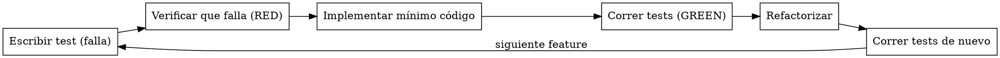
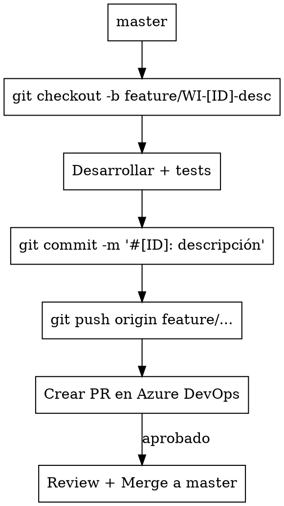
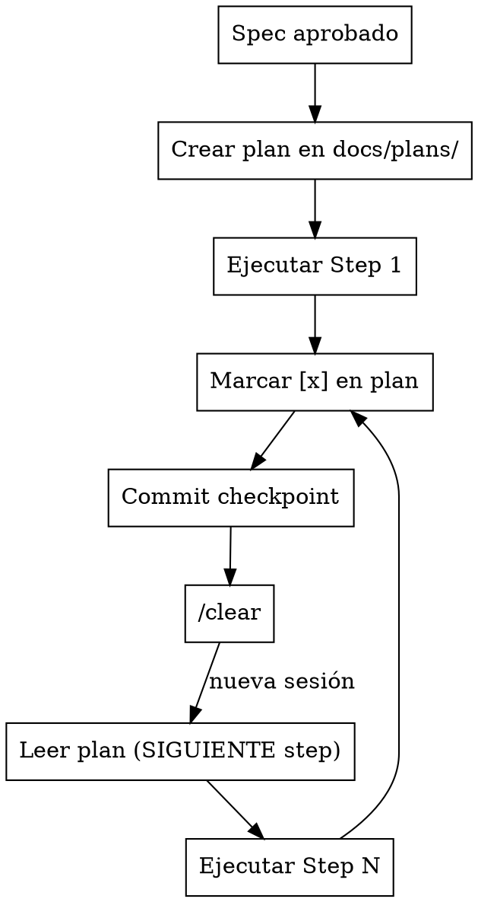

# CLAUDE.md — Estándares de Software FINDEP

## Rol

Actúa como arquitecto de software experto y desarrollador Senior.

---

## Ejecución & Entorno

<HARD-GATE>
NUNCA ejecutes comandos directamente en el host (pytest, python, mvn, dotnet).
Todo corre dentro del contenedor via docker exec.
Si estás a punto de correr un comando sin `docker exec`, DETENTE.
</HARD-GATE>

- **Solo Docker** — ninguna app corre directamente en el host.
  - ✅ `docker exec <nombre_servicio> pytest`
  - ✅ `docker compose up` (usar siempre `docker compose` v2, NO `docker-compose` v1)
  - ❌ `pytest` en el host
  - ❌ `python main.py` en el host
- **CI/CD via docker compose** — flujo obligatorio:
  ```bash
  docker compose build
  docker compose up -d
  docker exec <nombre_servicio> pytest
  ```

> **Nota:** `docker-compose` (con guión, v1) está deprecado en este entorno. Usar siempre `docker compose` (con espacio, v2).
- **Sistema operativo:** Ubuntu 20.04. En Windows usar WSL:
  ```bash
  wsl -d Ubuntu-20.04 -e bash -c "<comando>"
  ```

---

## Desarrollo Local con Watchdog (Python)

<HARD-GATE>
`docker-compose.yml` es EXCLUSIVAMENTE para desarrollo local y pruebas.
NUNCA se integra a UAT, staging ni producción.
Si estás a punto de usar docker-compose en un entorno compartido, DETENTE.
</HARD-GATE>

### Dos Modos — Dockerfile único, dos orquestaciones

| Modo | Dockerfile | Orquestación |
|------|-----------|-------------|
| Desarrollo/Test | `Dockerfile` (CMD con `watchmedo`) | `docker-compose.yml` |
| Producción/UAT | `Dockerfile.prod` | GKE manifests |

### CMD estándar en Dockerfile (dev)

```dockerfile
CMD ["watchmedo", "auto-restart", \
     "--directory=./", \
     "--pattern=*.py", \
     "--recursive", \
     "--", \
     "uvicorn", "app.main:app", "--host=0.0.0.0", "--port=8080"]
```

Dependencia requerida en `requirements-dev.txt`:
```
watchdog[watchmedo]
```

### Volume mount obligatorio

El bind mount `.:/app` es lo que permite a `watchmedo` detectar cambios del host dentro del contenedor. Sin él, el hot-reload no funciona.

```yaml
services:
  microservice:
    volumes:
      - .:/app  # ← obligatorio para watchdog
```

### Stack estándar de desarrollo

```yaml
# docker-compose.yml — SOLO DESARROLLO LOCAL
services:
  microservice:        # uvicorn + watchmedo (hot-reload)
  postgres:            # postgres:alpine con healthcheck
  locust:              # load testing (opcional, comentar si no se necesita)
  # redis:             # comentado por defecto, activar si el servicio lo requiere
```

### Flujo de arranque

```bash
# Primera vez
docker-compose up --build

# Subsecuentes (sin rebuild)
docker-compose up

# Editar un .py → watchmedo detecta el cambio y reinicia uvicorn automáticamente

# Correr tests (en otro terminal)
docker exec ${SERVICENAME}_service pytest
```

---

## Diseño & Código

- **SOLID obligatorio** — SRP, OCP, interfaces claras, inversión de dependencias.
- **DRY** — no duplicar lógica; extraer helpers y módulos reutilizables.
- **Prohibido crear Makefiles.**
- **Prohibido crear archivos `.sh`** para automatización. Todo flujo via `docker-compose` y comandos explícitos documentados.

### Import Path Rules

<HARD-GATE>
NUNCA uses rutas relativas con traversal (../ o ../../) para importar módulos, componentes, servicios o utilidades en ningún lenguaje.
Usa siempre @/ (frontend) o imports absolutos desde la raíz del paquete (backend).
</HARD-GATE>

```typescript
// ❌ BAD
import { Button } from '../../components/Button';
// ✅ GOOD
import { Button } from '@/components/Button';
```

```python
# ❌ BAD
from ../../services.user import UserService
# ✅ GOOD
from app.services.user import UserService
```

---

## Frontend React — Base Template

<HARD-GATE>
NUNCA inicialices un proyecto React desde cero (create-react-app, vite init, npx create-next-app, etc.).
Siempre clonar arq-example-sso rama tyson/beta. Ya trae SSO, Tailwind, aliases y hot-reload configurados.
Si estás a punto de correr cualquier scaffold de React, DETENTE.
</HARD-GATE>


### Desarrollo local con hot-reload (Docker)

Mismo principio que el watchdog de Python: volumen bind mount + servidor de desarrollo.

```yaml
# docker-compose.yml — SOLO DESARROLLO LOCAL
services:
  frontend:
    build: .
    volumes:
      - .:/app
      - /app/node_modules  # excluir node_modules del bind mount
    ports:
      - "3000:3000"
    command: npm run dev -- --host 0.0.0.0
    environment:
      - VITE_APP_ENV=development
```

Editar un `.tsx` / `.ts` → HMR actualiza el browser automáticamente, sin rebuild.

### Configuración de rutas — sin hardcode de URLs

<HARD-GATE>
NUNCA escribas URLs, hosts ni paths de API directamente en componentes o hooks.
</HARD-GATE>

### Import paths — siempre `@/`

```typescript
// ❌ BAD
import { Button } from '../../components/Button';
import { useAuth } from '../../../hooks/useAuth';

// ✅ GOOD
import { Button } from '@/components/Button';
import { useAuth } from '@/hooks/useAuth';
```

### Estructura de carpetas DRY


## Configuración — Sin Hardcode

<HARD-GATE>
NUNCA hardcodees valores: URLs, hosts, puertos, claves, nombres de servicios, timeouts, ni ningún literal que pueda variar entre entornos.
Todos los valores van en el archivo de configuración nativo del lenguaje. El código solo lee de ahí.
</HARD-GATE>


## Pruebas (TDD estricto, sin mocks)

<HARD-GATE>
Todo software DEBE tener pruebas de integración.
Las pruebas unitarias solas no son suficientes — se requiere al menos una prueba de integración
que valide el flujo completo con infraestructura real (DB, colas, APIs externas) via Testcontainers.
Si vas a entregar código sin pruebas de integración, DETENTE.
</HARD-GATE>

<HARD-GATE>
NUNCA uses mocks, stubs, fakes ni doubles bajo ninguna circunstancia.
Prohibido: unittest.mock, pytest-mock, monkeypatch, Moq, NSubstitute, Mockito.
Si estás a punto de importar cualquiera de estas librerías, DETENTE.
La única alternativa válida es un contenedor real vía Testcontainers.
</HARD-GATE>

<HARD-GATE>
TDD estricto: la prueba DEBE existir y FALLAR antes de escribir el código de producción.
Si ya tienes código implementado y aún no tienes test, estás violando TDD.
</HARD-GATE>

### Process Flow — Ciclo TDD



| Prohibido | Alternativa obligatoria |
|-----------|------------------------|
| `unittest.mock`, `patch`, `MagicMock` | Contenedor real de DB via Testcontainers |
| `pytest-mock`, `monkeypatch` | Servicio real en `docker-compose.test.yml` |
| `Moq`, `NSubstitute` (C#) | Testcontainers + base de datos real |
| `Mockito` (Java) | Testcontainers + infraestructura real |

```bash
docker-compose -f docker-compose.test.yml up -d
docker exec <nombre_servicio> pytest          # Python
docker exec <nombre_servicio> mvn test        # Java
docker exec <nombre_servicio> dotnet test     # C#
```


### Rama Única por Repo — `develop` ⭐

<HARD-GATE>
En TODOS los repos de este monorepo —el meta-repo `enid` y cada servicio/frontend anidado
(service-store, enid-store, service_leads, service_stock, service-faqs, service-landings,
service-oauth, service-references, reverse_proxy_nginx, service-notifications, etc.)— se
trabaja SIEMPRE y ÚNICAMENTE sobre la rama `develop`.

- NUNCA crear otras ramas (nada de `feature/...`, `fix/...`, `tyson/beta`, etc.).
- Al terminar cada Step/Task del plan, COMMITEAR en `develop` (no dejar cambios colgando).
- Todo avance vive commiteado en `develop`. Ningún progreso se queda sin commit ni vagando
  en otra rama.

Si estás a punto de hacer `git checkout -b` o estar en una rama distinta de `develop` en
cualquier repo, DETENTE.
</HARD-GATE>

**Por qué:** los servicios son repos git anidados dentro del meta-repo `enid`. Si el código
queda sin commitear o en ramas sueltas, el avance se pierde al cambiar de contexto o hacer
`/clear`. `develop` es la ÚNICA rama de integración viva, igual en todos los repos.

### Process Flow — Git Workflow



1. **Plan primero** — no se escribe código sin plan aprobado.
2. **Branch desde master:** `feature/WI-[ID]-descripcion` o `fix/WI-[ID]-descripcion`
3. **Commits con Work Item:** `#[WorkItemId]: descripción`
4. **PR obligatorio** — push a feature branch y crear PR.

---

## Workflow Spec → Plan → Ejecución ⭐ CRÍTICO

<HARD-GATE>
ANTES de escribir cualquier código verifica:
1. ¿Existe un spec aprobado? Si NO → pide el spec al usuario. No hay plan sin spec.
2. ¿Existe un plan en docs/plans/? Si NO → crea el plan primero. No hay código sin plan.
3. ¿Leíste el plan y ubicaste el siguiente step? Si NO → lee el plan AHORA.
No escribas ni una línea de código sin haber confirmado los tres puntos.
</HARD-GATE>

### Process Flow — Spec → Plan → Ejecución



**Orden obligatorio:**

1. **Spec primero** — documento aprobado. Sin spec no hay plan.
2. **Plan después** — Tasks con Steps y checkboxes `[ ]`. Sin plan no hay código.
3. **Ejecución step a step** — un Step por sesión. Al terminar: `[x]`, commit, `/clear`.

### Estructura del Plan

**Ubicación:** `docs/plans/YYYY-MM-DD-nombre-feature.md`

```markdown
# [Nombre Feature] — Plan de Implementación

**Spec:** [ruta al doc de diseño]
**Work Item:** #[ID]
**Branch:** feature/WI-[ID]-[descripcion]

## Task 1: [Nombre]

- [ ] **Step 1: [acción concreta]**
  - Archivos: `ruta/al/archivo.py`
  - Esperado: [resultado verificable]

---
**Progreso:** 0/N Steps (0%)
```

### Checkpoint Obligatorio (antes de /clear)

```bash
# 1. Marcar step: [ ] → [x] ✅ (YYYY-MM-DD HH:MM) y señalar ⏸️ SIGUIENTE
# 2. Commit
git add <archivos-del-step>
git commit -m "#[WI]: Step N - descripción"
# 3. /clear
```

### Al Iniciar Sesión Nueva ⭐

<HARD-GATE>
ANTES de escribir código en una sesión nueva, ejecuta esto y declara el resultado:
  cat docs/plans/[plan-file].md | grep -A5 "⏸️ SIGUIENTE"
  git log --oneline -3
Declara explícitamente: "Próximo step: [N] — toca [archivo X]".
PROHIBIDO escribir código sin haber hecho este review.
</HARD-GATE>

---

## docker-compose.test.yml — Tests con Testcontainers

El archivo `docker-compose.test.yml` es exclusivamente para correr tests de integración con testcontainers. Requiere montar el docker socket para que el contenedor pueda levantar subcontenedores.

```yaml
services:
  backend-test:
    build: .
    container_name: <servicio>-test
    volumes:
      - .:/app
      - /var/run/docker.sock:/var/run/docker.sock  # ← obligatorio para testcontainers
    environment:
      - APP_ENV=test
    command: tail -f /dev/null
```

Flujo de test:

```bash
docker-compose -f docker-compose.test.yml up -d
docker exec <servicio>-test pytest tests/ -v
docker-compose -f docker-compose.test.yml down
```

---

---

## Reverse Proxy nginx — CORS y Routing

### Arquitectura local

```
Browser (localhost)
  │
  ├─ puerto 80  → nginx → localhost:5173 (frontend Vue/React)
  └─ puerto 8000 → nginx → microservicios (8083, 8085–8089)
```

nginx corre con `network_mode: host` → accede a los servicios en `localhost:<puerto>`.

---

### Problema 1: Path mismatch entre frontend y nginx

El frontend llama sin prefijo (`/enid/`, `/oauth/`, `/lead/`).  
nginx debe rutar **sin `/api/`** y hacer strip del segmento de namespace:

```nginx
# ✅ CORRECTO — strip /enid/, upstream recibe /categorias/
location /enid/ {
    proxy_pass http://localhost:8085/;
}

# ❌ MAL — el frontend nunca llama /api/enid/
location /api/enid/ {
    proxy_pass http://localhost:8085/;
}
```

**Regla:** el nombre del `location` block = el prefijo que usa el frontend en sus llamadas axios.

**Excepción — cuando el servicio incluye el prefijo en sus propias rutas** (ej. service-landings expone `landings/templates/`):

```nginx
# Mantener prefijo: /landings/X → upstream recibe /landings/X
location /landings/ {
    proxy_pass http://localhost:8088/landings/;
}
```

Mapa completo de este proyecto:

| Frontend llama | nginx location | upstream:puerto | Strip prefix |
|---|---|---|---|
| `/enid/*` | `/enid/` | 8085 | sí → `/*` |
| `/oauth/*` | `/oauth/` | 8083 | sí → `/*` |
| `/logout/` | `/logout/` | 8083 | no → `/logout/` |
| `/lead/*` | `/lead/` | 8086 | sí → `/*` |
| `/stock/*` | `/stock/` | 8087 | sí → `/*` |
| `/landings/*` | `/landings/` | 8088 | mantiene → `/landings/*` |
| `/faqs/*` | `/faqs/` | 8089 | sí → `/*` |
| `/references/*` | `/references/` | 8082 | sí → `/*` |

---

### Problema 2: CORS bloqueado

**Causa raíz:** los servicios Django tienen `CORS_ALLOWED_ORIGINS = config('CORS_ALLOWED_ORIGINS', default='').split(',')`. Si la env var está vacía → lista `['']` → Django no agrega headers → browser bloquea.

**Solución: centralizar CORS en nginx** (no en cada servicio).

```nginx
# 1. Reflejar el origin del request (compatible con credentials: true)
map $http_origin $cors_origin {
    default                 "";
    "http://localhost"      "http://localhost";
    "http://localhost:5173" "http://localhost:5173";
}

server {
    listen 8000;

    # 2. Eliminar headers CORS del upstream para evitar duplicados
    proxy_hide_header Access-Control-Allow-Origin;
    proxy_hide_header Access-Control-Allow-Credentials;
    proxy_hide_header Access-Control-Allow-Methods;
    proxy_hide_header Access-Control-Allow-Headers;

    location /enid/ {
        # 3. Responder OPTIONS (preflight) sin llegar al upstream
        if ($request_method = OPTIONS) {
            add_header Access-Control-Allow-Origin $cors_origin;
            add_header Access-Control-Allow-Credentials true;
            add_header Access-Control-Allow-Methods 'GET, POST, PUT, PATCH, DELETE, OPTIONS';
            add_header Access-Control-Allow-Headers 'Authorization, Content-Type, X-Store-Id';
            return 204;
        }
        # 4. Agregar CORS en cada respuesta real
        add_header Access-Control-Allow-Origin $cors_origin always;
        add_header Access-Control-Allow-Credentials true always;
        add_header Access-Control-Allow-Methods 'GET, POST, PUT, PATCH, DELETE, OPTIONS' always;
        add_header Access-Control-Allow-Headers 'Authorization, Content-Type, X-Store-Id' always;

        proxy_pass http://localhost:8085/;
        proxy_set_header Host $host;
        proxy_set_header X-Real-IP $remote_addr;
        proxy_set_header X-Forwarded-For $proxy_add_x_forwarded_for;
        proxy_set_header X-Forwarded-Proto $scheme;
    }
    # ... mismo patrón para cada location
}
```

**Por qué `$cors_origin` y no `*`:**  
`Access-Control-Allow-Credentials: true` es incompatible con `Access-Control-Allow-Origin: *`. El `map` refleja el origin exacto del request → mismo efecto que `*` pero compatible con credentials.

**Por qué `proxy_hide_header`:**  
Si un servicio upstream (ej. service-landings con `CORS_ALLOW_ALL_ORIGINS = True`) ya agrega sus propios headers CORS, se duplican y el browser rechaza la respuesta. `proxy_hide_header` a nivel server elimina los upstream antes de que nginx agregue los suyos.

---

### Diagnóstico rápido cuando hay errores CORS/routing

```bash
# 1. ¿OPTIONS preflight responde 204?
curl -s -o /dev/null -w "%{http_code}" -X OPTIONS http://localhost:8000/<ruta>/ \
  -H "Origin: http://localhost" -H "Access-Control-Request-Method: GET"
# Esperado: 204

# 2. ¿La ruta llega al upstream?
curl -s -o /dev/null -w "%{http_code}" http://localhost:8000/<ruta>/
# 200/404 = nginx llegó al upstream | 502 = upstream caído | 404 sin upstream = location no matchea

# 3. ¿Qué headers CORS retorna?
curl -s -I http://localhost:8000/<ruta>/ -H "Origin: http://localhost" | grep Access-Control

# 4. ¿El archivo de config está cargado en el contenedor?
docker exec enid_nginx cat /etc/nginx/conf.d/default.conf | head -5
```

**Truco del inodo:** si editas `proxy.conf` con una herramienta que hace rename atómico (escribe a tmp y renombra), el bind mount del contenedor apunta al inodo viejo y NO ve los cambios aunque el archivo en el host esté actualizado. Solución:

```bash
# Reiniciar el contenedor para que remonte el path (no el inodo)
docker compose restart nginx

# Verificar que el contenedor cargó el nuevo archivo
docker exec enid_nginx nginx -t
```

---

when talking to me, sacrifice grammar for the sake of concision.

## Credenciales de Desarrollo Local

| Campo | Valor |
|-------|-------|
| Usuario (admin) | `enidservice@gmail.com` |
| Contraseña | `enidservice@gmail.com` |

Para verificar en browser como admin, hacer login en `http://localhost/login` con estas credenciales.


<HARD-GATE>
El software solo se considera aprobado cuando cuenta con pruebas de integración 
</HARD-GATE>
